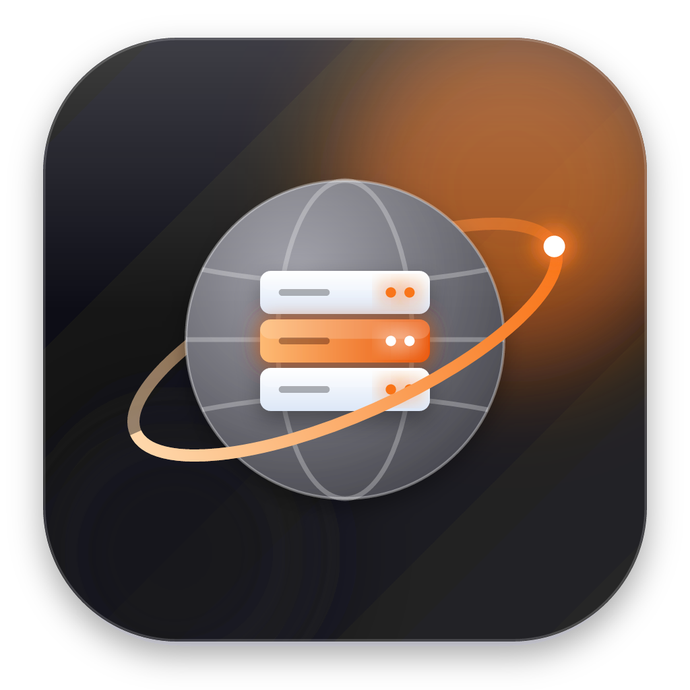

# Sentry Rack

## Team
| Name | Student ID |
|------|------------|
| Duc Anh Vo | N01729381 |
| Andres Zambrano | N01495324 |
| Krushna Patel | N01713093 |
| Anvesh Rachakonda | N01661293 |

## Project Image
###
<table>
  <tr>
    <td></td>
    <td></td>
    <td></td>
  </tr>
</table>

## Description

    
    

SentryRack is an Android IoT monitoring app for real-time environmental and security monitoring of data center server racks.

•⁠  ⁠Connects to a multi-sensor network installed on or around a server rack
•⁠  ⁠Monitors coolant/water levels, current draw, unauthorized rack access, and air quality (VOCs)
•⁠  ⁠Sends real-time alerts when sensor readings exceed set thresholds
•⁠  ⁠Logs historical data for trend analysis and preemptive maintenance
•⁠  ⁠Helps reduce downtime, prevent equipment damage, and improve physical security
•⁠  ⁠Designed for IT staff and facility managers in data centers and server rooms

## Project Link
https://github.com/DucAnhVo9381/SentryRack

## Built With

•⁠  ⁠Android Studio
•⁠  ⁠Java
•⁠  ⁠Raspberry Pi + IoT Sensors
•⁠  ⁠Water Level Sensor
•⁠  ⁠ACS723 Current Sensor
•⁠  ⁠SparkFun TMAG5273 3D Hall Effect Sensor
•⁠  ⁠SparkFun ENS160 Air Quality Sensor