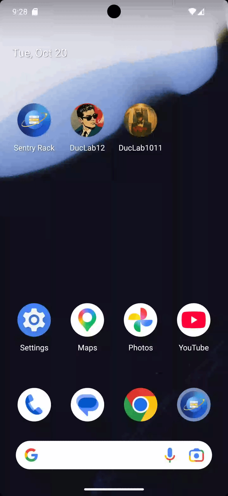
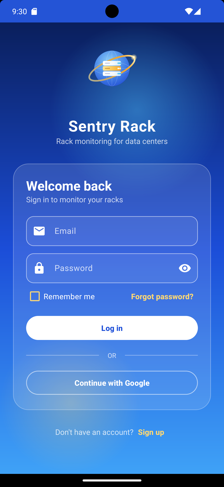
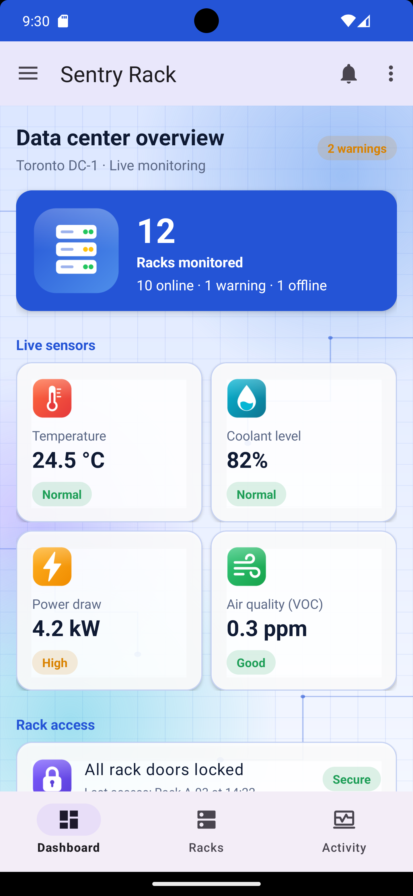
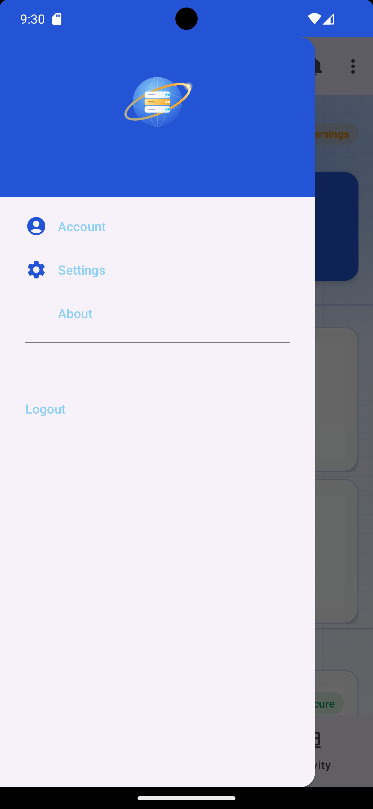

## Sentry Rack
<p align="center">
    
    
</p>

### Group 4
- Duc Anh Vo - N01729381.
- Andres Zambrano - N01495324.
- Krushna Patel - N01713093.
- Anvesh Rachakonda - N01661293.

GitHub Repository: [](https://github.com/DucAnhVo9381/SentryRack)

### App Screens
<table>
    <tr>
        <td></td>
        <td></td>
    </tr>
    <tr>
        <td></td>
        <td></td>
    </tr>
</table>

### Description
**Sentry Rack** is a rack-level monitoring platform designed to help technicians monitor, manage, and maintain individual server racks.

> [!NOTE]
>Rather than simply displaying raw sensor values, SentryRack transforms monitoring events into meaningful 
> operational insights that improve visibility into rack health, activity, incidents, and lifecycle 
> history. The platform helps users understand what is happening now, what has happened before, and what 
> may require attention next.

#### Core Philosophy:
Traditional monitoring systems focus on displaying sensor readings:

```text
Sensor Reading
      ↓
 Display Value
```

SentryRack focuses on transforming monitoring data into actionable information:

```text
Sensor Reading
      ↓
 Monitoring Event
      ↓
 Meaningful Information
      ↓
 Visibility & Understanding
      ↓
 Actionable Decision
```
This approach helps technicians focus on the condition of the rack rather than interpreting individual sensor values.

#### Target Users:
- Data Center Technicians
- Server Room Operators
- Infrastructure Support Teams
- Facilities Personnel responsible for rack environments
- Organizations seeking rack-level operational visibility

---

### Key Features
#### Security Monitoring
- Detect rack access events using a Hall Effect sensor
- Track access history and activity records
- Monitor rack access frequency and duration
- Generate access-related alerts and notifications

#### Operational Activity Monitoring
- Monitor rack activity through current consumption analysis
- Detect operational changes and abnormal activity patterns
- Generate activity-based warnings and alerts
- Maintain operational history records

#### Environmental Health Monitoring
- Track environmental conditions surrounding rack equipment
- Detect significant environmental changes
- Generate environmental warnings when abnormal conditions occur
- Maintain environmental monitoring history

#### Incident Protection
- Detect unexpected liquid presence near equipment
- Generate leak alerts and incident notifications
- Record and maintain incident history
- Support rapid incident response workflows

#### Rack Lifecycle Management
- Maintain rack health records
- Store access history and operational events
- Track environmental warnings and incidents
- Record maintenance activities
- Provide historical context for troubleshooting and decision-making

---

### Tools and Resources
#### Software
- Android Studio for Android development
- Java
- Android SDK
- Git for version management
- GitHub for source control and collaboration

#### Hardware
- Raspberry Pi
- TMAG5273 Hall Effect Sensor
- ACS723 Current Sensor
- ENS160 Environmental Sensor
- Water Detection Sensor

---

<p align="center">
    
</p>